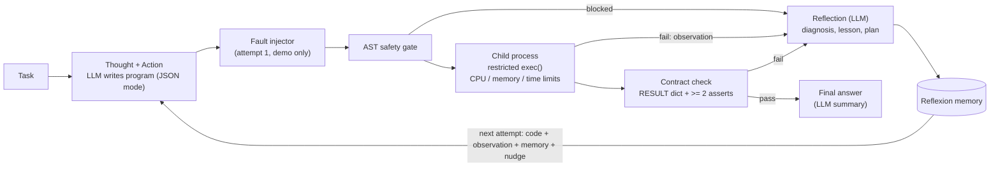

# QuantSolve: a self-verifying, self-healing solver for quantitative problems

| Name | Roll no | Batch |
|---|---|---|
| Deon Menezes | 16014223030 | B1 |
| Aishwarya Gawali | 16014223007 | B1 |

**Course:** Generative AI Laboratory, Lab CA

**Repository:** <https://github.com/DeonMenezes-11/QuantSolve>

| Document | What it is |
|---|---|
| [`paper/QuantSolve_IEEE.pdf`](paper/QuantSolve_IEEE.pdf) | IEEE-format paper (two-column, 6 pages) |
| [`report/QuantSolve_Report_Deon_Menezes_Aishwarya_Gawali.pdf`](report/QuantSolve_Report_Deon_Menezes_Aishwarya_Gawali.pdf) | full lab report (19 pages) |
| [`docs/QuantSolve_Explained.pdf`](docs/QuantSolve_Explained.pdf) | three-page plain-English explanation of the project |

> Lab theme: *Self-Correction "Code Execution & Auto-Heal" Loop* (ReAct / Reflexion). Build a
> Python execution loop that takes a complex user task, generates Python code, runs it in a safe
> execution environment, captures tracebacks on failure, and iteratively fixes the code.

QuantSolve takes a quantitative word problem (loans, SIPs, tax, physics, probability, inventory,
counting), asks an LLM (`gpt-4.1-mini` by default, set with `OPENAI_MODEL`) to write a Python
program for it, runs that program in a
**restricted `exec()` inside a child process**, and repairs the program until it passes its own
self-checks. Every program must:

- compute everything in code and put the answer in a dict called `RESULT`, and
- contain **at least two `assert` self-checks** that compare quantities computed in different
  ways (loop vs closed form, parts vs total, DP vs brute force ...).

So the loop does not only heal crashes; it also heals *logic* bugs that the asserts expose.

## How it maps to ReAct and Reflexion

| Idea | In QuantSolve |
|---|---|
| ReAct *Thought* | the model's short plan (method, formulas, which invariants it will assert) |
| ReAct *Action* | the generated program |
| ReAct *Observation* | sandbox result: `RESULT`, or a failure kind + cleaned traceback / failed assert |
| Reflexion *self-reflection* | after each failure a separate call returns `{diagnosis, reflection, next_plan}` |
| Reflexion *episodic memory* | all reflections so far are shown to every later attempt |
| Loop guard | identical code (normalised AST hash) or the same error twice -> "change approach" nudge |

## Architecture



```
quantsolve/
  config.py       settings from .env (model, QS_MAX_ATTEMPTS=5, QS_TIMEOUT=10, temperatures)
  llm.py          OpenAI chat wrapper: JSON mode, retry, token + cost accounting
  prompts.py      SOLVE / REFLECT / SUMMARIZE prompts and observation formatting
  sandbox.py      AST gate, SAFE_BUILTINS + guarded __import__, spawn child, failure taxonomy
  faults.py       "inject a bug" switch: crash (misspelled variable) / logic (off-by-one, flipped sign)
  agent.py        the ReAct + Reflexion loop, loop guard, live events, JSON traces in runs/
  tasks.py        8 sample problems with hand-written reference answers + scoring
  benchmark.py    one-shot vs loop vs loop+injected bug -> results/benchmark.{json,csv}
  safety_eval.py  17 escape / exhaustion attacks -> results/safety.json
cli.py            rich CLI
web.py            starts the website (python3 web.py -> http://127.0.0.1:8503)
webapp/
  server.py       FastAPI: JSON API, Server-Sent Events stream of loop steps, static files
  jobs.py         background solve jobs (thread per run, replayable event log, Stop flag)
  data.py         sample catalogue, history index, benchmark/safety loaders (read-only)
  static/         hand-written front end: index.html, css/app.css, js/ (no framework, no build)
tests/            offline pytest suite (no API calls), incl. test_web.py for the API
report/           build_report.py (PDF), figures.py, capture_ui.py (screenshots), figures/, the PDF
paper/            make_paper.py -> QuantSolve_IEEE.tex / .pdf (IEEEtran, numbers read from results/)
docs/             build_explainer.py -> QuantSolve_Explained.pdf
runs/             saved traces (runs/bench/ holds benchmark traces)
results/          benchmark.json/csv, safety.json
```

### Failure kinds

| kind | when |
|---|---|
| `blocked` | the AST gate rejected an import / name / attribute / format string |
| `syntax` | the code does not parse |
| `runtime` | any exception except `AssertionError` (also the memory watchdog) |
| `assertion` | a self-check failed: the program is internally inconsistent |
| `timeout` | wall-clock limit (default 10 s) or the CPU rlimit |
| `contract` | fewer than 2 asserts, `RESULT` missing / not a dict / not JSON-serialisable |

## Web app

`python3 web.py` serves a single-page website (FastAPI backend + hand-written HTML/CSS/JS, light and
dark themes, works on phones). Every step of the loop is streamed to the browser live over
Server-Sent Events.

| Page | What it does |
|---|---|
| **Solve** | pick one of the 8 examples (or write a problem), choose the model, attempt budget and an optional demo bug, press Solve (⌘/Ctrl + Enter). A pipeline stepper shows where each attempt is (Plan & code → Safety gate → Run → Self-checks → Reflect); each attempt card has Thought / Code / Observation / Reflection tabs, with the failing line highlighted, the injected fault marked and a diff against the previous attempt. The verified answer shows every `RESULT` value, checked against the hand-written reference for sample problems. Runs can be stopped, and survive a page refresh. |
| **History** | every saved run (yours, benchmark, archive) with search and filters; coloured dots show each run's path (crash → fixed, self-check failed → fixed ...). |
| **Run replay** (`#/run/<run id>`) | a saved trace rendered with the same components as a live run, plus run facts, the Reflexion memory and a share link. |
| **Results** | benchmark KPIs, accuracy / attempts / cost per arm, gpt-4o-mini vs gpt-4.1-mini, a clickable task × arm heatmap, injected-bug attribution and the 17-attack safety table. |
| **How it works** | the loop diagram, ReAct / Reflexion / self-verification, the six sandbox layers and the failure kinds. |

API (all JSON unless noted; interactive docs at `/api/docs`):

| Method | Path | Purpose |
|---|---|---|
| GET | `/api/meta` | models, defaults, whether an API key is configured, team |
| GET | `/api/tasks` | the sample problems |
| POST | `/api/runs` | start a solve job `{problem, model, max_attempts, inject}` → `{job_id}` |
| GET | `/api/runs/{job}/events` | **SSE** stream: `started`, `attempt_start`, `action`, `observation`, `reflection`, `summarizing`, `final`, `error`, `end` |
| POST | `/api/runs/{job}/stop` | stop after the current step |
| GET | `/api/history?scope=mine\|bench\|archive\|all` | saved runs |
| GET | `/api/history/{run_id}` | one trace + its score against the reference |
| GET | `/api/results` | benchmark, model comparison, safety evaluation |

The server binds to `127.0.0.1` only, model output is always rendered as text (never HTML), and
the API key never leaves `.env`. Screenshots are in `report/figures/ui_*.png`.

## Setup

```bash
cp .env.example .env          # then put your OpenAI key in .env
pip install -r requirements.txt
python3 -m pytest             # offline tests, no API calls
```

`.env` is loaded with an explicit path (`load_dotenv(<project>/.env)`), so the tools work from
any working directory and from stdin. The key never reaches the sandbox: the child process
deletes every environment variable except a few harmless ones before running generated code.

## Usage

```bash
python3 cli.py tasks                                   # list sample problems
python3 cli.py run-task loan_prepay --inject logic     # solve + score against the reference
python3 cli.py run-task income_tax --inject crash
python3 cli.py solve "A machine costs Rs 8,00,000 and depreciates 15% a year (WDV). \
  Book value after 6 years? RESULT keys: book_value." --max-attempts 4
python3 cli.py bench --repeats 2 --workers 4           # benchmark (uses the API, ~US$0.21 with gpt-4.1-mini)
python3 cli.py bench --rescore [results/archive/x.json]  # recompute scores from saved traces (offline)
python3 cli.py safety                                  # sandbox attack suite (offline)

python3 web.py                                         # website at http://127.0.0.1:8503 (opens the browser)
python3 web.py --port 9000 --no-browser                # other port, no browser tab
python3 report/build_report.py                         # rebuild the lab report from results/ and runs/
python3 paper/make_paper.py                            # rebuild the IEEE paper (needs pdflatex + IEEEtran)
python3 docs/build_explainer.py                        # rebuild the 3-page explainer
```

### Sample output (excerpt of `run-task sip_stepup --inject logic`, run `20261004-235610_sip_stepup_inject-logic`)

```
──────────────────────────────── Attempt 1 ─────────────────────────────────
╭───────────────────────── Injected fault (demo) ──────────────────────────╮
│ logic: off-by-one in range() on line 7: `range(1, months + 1)` ->        │
│ `range(1, months)`                                                       │
╰──────────────────────────────────────────────────────────────────────────╯
╭─────────────────────── Observation #1: ASSERTION ────────────────────────╮
│ Traceback (solution frames only):                                        │
│   line 22, in <module>                                                   │
│     assert abs(total_invested - total_invested_check) < 1e-06, f'Total   │
│ invested mismatch: {total_invested} vs {total_invested_check}'           │
│ AssertionError: Total invested mismatch: 3774722.81994046 vs             │
│ 3812697.8032987844                                                       │
╰──────────────────────────────────────────────────────────────────────────╯
╭──────────────────── Reflection #1 (stored in memory) ────────────────────╮
│ Diagnosis: The loop on line 7 uses range(1, months), which iterates from │
│ 1 to 179, missing the 180th instalment ...                               │
│ Next plan: Change the loop on line 7 to range(1, months + 1) ...         │
╰──────────────────────────────────────────────────────────────────────────╯
──────────────────────────────── Attempt 2 ─────────────────────────────────
╭─────────────── Observation #2: ok (2 self-checks passed) ────────────────╮
│ RESULT = {"total_invested": 3812698, "future_value": 8683849,            │
│           "wealth_gained": 4871152, "fv_without_stepup": 5045760}        │
╰──────────────────────────────────────────────────────────────────────────╯
attempts: 2 | LLM calls: 4 | tokens: 3920 in + 1606 out | cost: $0.00414
Score vs hand-written reference: CORRECT
```

Re-running the model's original (un-mutated) attempt-1 program passes all checks, so here the
failure really was caused by the injected bug, and the reflection named the exact line.

## Results

Final benchmark: 8 problems x 2 repetitions, `gpt-4.1-mini`, max 5 attempts, 10 s timeout
(`results/benchmark.json`, created by `python3 cli.py bench --repeats 2 --workers 4`).

| Arm | Runs | Correct | Verified | Verified but wrong | Avg attempts | Healed | Tokens | Cost (USD) |
|---|---|---|---|---|---|---|---|---|
| one-shot | 16 | 11 (69%) | 12 | 1 | 1.00 | 0 | 37,254 | 0.0389 |
| loop (QuantSolve) | 16 | 13 (81%) | 16 | 3 | 1.19 | 2 | 51,313 | 0.0459 |
| loop + logic bug on attempt 1 | 16 | 8 (50%) | 16 | 8 | 1.88 | 7 | 98,482 | 0.0786 |
| loop + crash bug on attempt 1 | 6 | 5 (83%) | 5 | 0 | 3.00 | 5 | 67,838 | 0.0485 |

Total benchmark cost: US$0.212. *Verified* = final program passed its own asserts;
*healed* = attempt 1 failed and a later attempt passed.

**Model comparison** (same tasks, arms, prompts and repeats; the gpt-4o-mini run is archived in
`results/archive/benchmark_gpt-4o-mini.json`):

| Model | One-shot | Loop | Loop + logic bug | Loop + crash bug | Loop: verified but wrong |
|---|---|---|---|---|---|
| gpt-4o-mini | 1/16 (6%) | 5/16 (31%) | 4/16 (25%) | 2/6 (33%) | 7/16 |
| gpt-4.1-mini | 11/16 (69%) | 13/16 (81%) | 8/16 (50%) | 5/6 (83%) | 3/16 |

The loop removed 27% of the one-shot errors with gpt-4o-mini and 40% with gpt-4.1-mini, and the
stronger model's repairs ended "verified but wrong" less often. The loop's benefit depends on
how well the base model can read an observation, find the real cause and write a correct fix.

**Did the self-checks catch the injected bugs?** The model's original attempt-1 program is re-run
offline to attribute each injected run (gpt-4.1-mini):

| Arm | Caught | Silent (wrong but passed checks) | Benign | Original already failed | Not applied |
|---|---|---|---|---|---|
| logic bug | 2 | 5 | 2 | 5 | 2 |
| crash bug | 4 | 0 | 0 | 2 | 0 |

Honest reading: crash bugs are easy (the interpreter raises them and the loop repairs them), but
of the 9 logic bugs that could be attributed, the model's own asserts caught only 2 and let 5
through as verified-but-wrong answers (e.g. run `20261004-235320_compound_varying_inject-logic`,
where a year was dropped from the compounding loop and all 3 checks still passed). Self-written
checks only protect what they compare.

The benchmark also exposed a false positive in the AST gate: 4 attempts were blocked because the
model used `__` / `___` as throwaway loop variables. Fixed after the run (a name counts as a
dunder only if it contains non-underscore characters) with a regression test; the numbers above
are from before the fix.

Safety evaluation (`python3 cli.py safety`, `results/safety.json`): **17/17 attacks contained**
(11 blocked by the AST gate, 2 killed by the timeout, 1 killed by the memory watchdog, 2 stopped by
the runtime layers with the gate disabled, and 1 frame-walk escape with the gate disabled that
reached `os.environ` but found no API key because the child's environment is scrubbed).

Tests: `python3 -m pytest` -> 70 passed (offline, about 5 s).

## Safety notes and limitations

- **Restricted `exec()` is not a hard security boundary.** CPython objects can be introspected
  back to the real interpreter (e.g. `().__class__.__base__.__subclasses__()`, generator frames,
  modules that re-export `os`/`sys`). QuantSolve therefore layers its defences:
  1. **AST gate**: import allow-list (`math, cmath, statistics, fractions, decimal, itertools,
     functools, collections, datetime, random, heapq, bisect, numpy`); blocked names (`eval,
     exec, compile, open, __import__, input, breakpoint, exit, quit, globals, locals, vars,
     getattr, setattr, delattr, memoryview`); no attribute starting with `_`; no frame/generator
     attributes, re-exported modules (`statistics.sys`) or numpy file I/O (`np.load`, `tofile`);
     no format strings that read such attributes. A test walks all public attributes reachable
     from the allowed modules and checks no dangerous module is reachable.
  2. **Restricted builtins** with a guarded `__import__` that re-checks the allow-list at run time.
  3. **Separate process** (`multiprocessing` spawn) with a **scrubbed environment** (no API key).
  4. **Limits**: `RLIMIT_CPU`, an RSS watchdog (1 GB; macOS ignores memory rlimits) and a
     wall-clock timeout (terminate, then kill).
- The safety evaluation shows the honest picture: with the AST gate switched off a frame walk
  *does* reach `os.environ` in the child; it only finds nothing because the environment was
  scrubbed. For untrusted users use a container / VM / WebAssembly Python instead.
- The self-checks are written by the same model, so they can be wrong (false alarms) or too weak
  ("verified but wrong" results). The benchmark reports both.
- Small benchmark (8 problems, 2 repetitions) and two small models: treat the percentages as
  indicative, not definitive.
- `results/archive/` keeps earlier benchmarks: `benchmark_gpt-4o-mini.json` (same setup with
  gpt-4o-mini, used for the model comparison; traces in `runs/archive_gpt-4o-mini/`) and
  `benchmark_v1.json` (an early gpt-4o-mini run made before the last prompt fixes; traces in
  `runs/archive_v1/`). `python3 cli.py bench --rescore results/archive/<file>.json` re-scores
  any of them offline.
